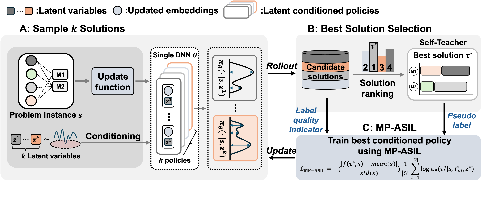

<h1 align="center">
Towards Generalizable Multi-Policy Optimization 
  
with Self-Evolution for Job Scheduling
</h1>


>This repository is the official implementation of our paper **Towards Generalizable Multi-Policy Optimization with Self-Evolution for Job Scheduling**, Advances in Neural Information Processing Systems (NeurIPS), vol. 38, pp. 24569–24616, 2025.

<p align="center">
  
</p>

## Abstract

Reinforcement Learning (RL) has shown promising results in solving Job Scheduling Problems (JSPs), automatically deriving powerful dispatching rules from data without relying on expert knowledge. However, most RL-based methods train only a single decision-maker, which limits exploration capability and leaves significant room for performance improvement. Moreover, designing reward functions for different JSP variants remains a challenging and labor-intensive task.
To address these limitations, we introduce a novel and generic learning framework that optimizes multiple policies sharing a common objective and a single neural network, while enabling each policy to learn specialized and diverse strategies.
The model optimization process is fully guided by a self-labeling manner, eliminating the need for reward functions.
In addition, we develop a training scheme that adaptively controls the imitation intensity to reflect the quality of self-labels. Experimental results show that our method effectively addresses the aforementioned challenges and significantly outperforms state-of-the-art RL methods across six JSP variants.
Furthermore, our approach also demonstrates strong performance on other combinatorial optimization problems, highlighting its versatility beyond JSPs.

## 💻 Code Availability

🧑‍💻 The code for this paper is available in the **Supplemental** material on the [NeurIPS 2025 Proceedings page](https://papers.nips.cc/paper_files/paper/2025/hash/2330c4be5e12c504705ba1db8a507966-Abstract-Conference.html).

---
📝 If you find our code valuable for your research, please cite:
```bibtex
@article{choi2026towards,
  title={Towards Generalizable Multi-Policy Optimization with Self-Evolution for Job Scheduling},
  author={Choi, Inguk and Shin, Woo-Jin and Cho, Sang-Hyun and Kim, Hyun-Jung},
  journal={Advances in Neural Information Processing Systems},
  volume={38},
  pages={24569--24616},
  year={2025}
}
```
